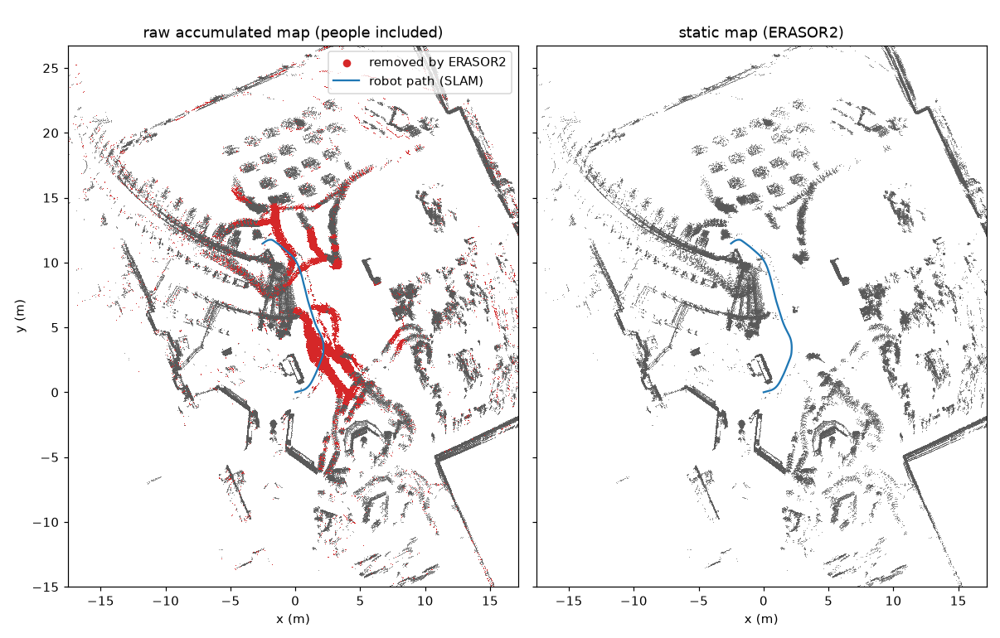

# Static maps from ACME recordings

Each ACME robot recording can be turned into a **static 3D point-cloud map** of the place it
was recorded in, with the moving people removed. The map comes from the robot's own LiDAR and
odometry in the raw ROS 2 bag; no camera data or manual annotation is needed:

1. **Offline LiDAR SLAM** (KISS-ICP + GTSAM) gives a drift-corrected pose for every scan and
   a raw accumulated map, which still contains every person that walked past.
2. **ERASOR2** dynamic-object removal compares the scans over time and deletes the points of
   whatever moved, leaving the static map.



*Miraikan, `03-08-2025-1-3F_Geo_Cosmos_0_0_13` (17.6 s, 174 scans, 15 m path): top-down view of
points 0.15-2 m above the floor. Left: raw accumulated map; red = points ERASOR2 removed (the
trails of people walking past the robot). Right: the static map. Produced by the command in
[Quick start](#quick-start) in 23 s.*

This folder holds the scripts and instructions. Two external tools are needed and are not
included: [ERASOR2](https://github.com/url-kaist/ERASOR2) (C++, GPLv3) and the Python packages
listed under [Setup](#setup).

## Pipeline

```
raw bag (.zip from ROS2_Bags/<institution>/)
  │  lidar + odometry (+ IMU)
  ▼
run_slam.py ───────► poses (TUM), raw map.pcd, slam_qc.json
  ▼
export_scans.py ───► scans + poses in ERASOR2's layout (erasor2/data/Merged/)
  ▼
gen_labels.py ─────► per-scan ground (Patchwork++) and instance (HDBSCAN) labels
  ▼
run_erasor2 ───────► static map (lifted by the sensor height)
  ▼
finalize_map.py ───► erasor2/output/static_map_slam_frame.pcd + summary.json
plot_maps.py ──────► erasor2/static_map.png
```

`scripts/run_static_map.py` runs all steps for one bag and skips every step whose output
already exists, so a rerun resumes after a failure.

| Script | What it does |
|---|---|
| [`scripts/run_static_map.py`](scripts/run_static_map.py) | Driver for one bag (folder or zip): extracts the zip, writes the robot profile, runs the steps below, fills the ERASOR2 config. |
| [`scripts/dataset_profile.py`](scripts/dataset_profile.py) | Robot/sensor setup per dataset: lidar topic and point layout, odometry/IMU topics, base-to-lidar transform, lidar height, attitude source. |
| [`scripts/run_slam.py`](scripts/run_slam.py) | Offline SLAM. Writes `map.pcd` (5 cm voxels), `map_full_res.pcd` (2 cm), `poses_base_link_tum.txt`, `poses_rslidar_tum.txt`, `slam_qc.json`. |
| [`scripts/export_scans.py`](scripts/export_scans.py) | Scans (5 cm voxels, `float32 x y z intensity`) and KITTI-format poses in the layout of ERASOR2's HeLiPR loader. |
| [`scripts/gen_labels.py`](scripts/gen_labels.py) | Patchwork++ ground segmentation (sensor height from the profile) and HDBSCAN instances per scan, in parallel. |
| [`scripts/erasor2_template.yaml`](scripts/erasor2_template.yaml) | ERASOR2 configuration, scaled for small robots (0.4 m grid, 10 m range of interest). |
| [`scripts/finalize_map.py`](scripts/finalize_map.py) | Moves the ERASOR2 map back into the SLAM frame and writes stats (`points`, `raw_voxels_removed`). |
| [`scripts/plot_maps.py`](scripts/plot_maps.py) | The figure above for any bag. |

## Setup

The maps of the batch run below were made with two Python environments (one for SLAM, one for
labelling and ERASOR2 post-processing); one environment with all packages may work too.

```bash
# SLAM environment (Python 3.11)
conda create -n kiss_icp python=3.11 && conda activate kiss_icp
pip install kiss-icp==1.3.0 gtsam==4.3.0 open3d==0.20.0 rosbags==0.11.5 scipy numpy

# labelling / ERASOR2 environment (Python 3.12)
conda create -n erasor2 -c conda-forge python=3.12 hdbscan=0.8 scikit-learn matplotlib scipy && conda activate erasor2
pip install pypatchworkpp==1.4.1 open3d==0.20.0

# ERASOR2 (ROS-free build; needs Eigen3, PCL, Boost, OpenCV, OpenMP, yaml-cpp)
git clone https://github.com/url-kaist/ERASOR2.git ~/ERASOR2
cd ~/ERASOR2 && git checkout d43d94f && cmake -B build -S . && cmake --build build -j
```

The maps below were made with ERASOR2 at commit `d43d94f`
(also mirrored at [raoshashank/ERASOR2_minimal](https://github.com/raoshashank/ERASOR2_minimal)).

## Quick start

Download one bag (the `acme-dataset` command comes with this repository, see the main
[README](../README.md)) and build its map:

```bash
acme-dataset download raw -i miraikan -n 03-08-2025-1-3F_Geo_Cosmos_0_0_13

python static_map_extraction/scripts/run_static_map.py \
    "ACME-dataset/ROS2_Bags/miraikan/03-08-2025-1-3F_Geo_Cosmos_0_0_13.zip" \
    --profile miraikan --out maps/ \
    --erasor2 ~/ERASOR2/build/run_erasor2 \
    --slam-python ~/miniconda3/envs/kiss_icp/bin/python \
    --labels-python ~/miniconda3/envs/erasor2/bin/python
```

The bag is extracted to `maps/bags/`. Results are in `maps/<bag>/slam_output/`:

| File | Content |
|---|---|
| `erasor2/output/static_map_slam_frame.pcd` | **static map**, SLAM `map` frame |
| `map.pcd`, `map_full_res.pcd` | raw accumulated map (people included), 5 cm / 2 cm voxels |
| `poses_base_link_tum.txt`, `poses_rslidar_tum.txt` | robot and lidar pose per scan, TUM format (`t x y z qx qy qz qw`) |
| `poses_base_link_kiss_only_tum.txt`, `robot_odom_tum.txt` | frontend-only poses and the onboard odometry, for comparison |
| `slam_qc.json` | worst 1 s disagreement between SLAM and the onboard odometry; `flag` = suspect SLAM |
| `erasor2/summary.json` | static map points, fraction of raw-map voxels removed |
| `erasor2/static_map.png` | top-down figure |
| `dataset.json` | the robot profile used |

The `map` frame has its origin at the robot's `base_link` at the first scan, z up (gravity
aligned) and x along the initial heading. Maps are per recording; recordings of the same place
are not aligned to each other. View a map with Open3D, CloudCompare or PCL:

```python
import open3d as o3d
o3d.visualization.draw_geometries([o3d.io.read_point_cloud("maps/<bag>/slam_output/erasor2/output/static_map_slam_frame.pcd")])
```

## Robots

`dataset_profile.py` has profiles for two robots:

| Profile | Robot | LiDAR | Pose source |
|---|---|---|---|
| `go2nus` | Unitree Go2 (NUS) | Hesai XT-16 `/rslidar_points` with per-point time stamps, 0.38 m above the ground | `/utlidar/robot_odom` (its orientation gives gravity) |
| `miraikan` | CaBot suitcase robot (Miraikan) | Velodyne VLP-16 `/velodyne_points`, 0.553 m above the floor | `/odom` (planar), gravity from the floor plane seen in each scan with `/cabot/imu/data` as fallback |

Other ACME robots need a profile: lidar topic and the byte offsets of `x y z intensity` (and of
a per-point time stamp, if any), odometry topic, IMU topic (or none if the odometry carries
roll and pitch), base-to-lidar translation and yaw, lidar height above the ground. The static
transforms of each robot are in `sampled_data/extrinsics_intrinsics/<institution>/_tf_static.txt`
on Hugging Face (`acme_dataset.calibration.read_tf_static_txt` reads them).

## Method details

**SLAM** (`run_slam.py`)
- Frontend: KISS-ICP scan-to-map registration (0.5 m voxels, 0.6-80 m range; the 0.6 m minimum
  drops returns from the robot body). Deskewing is off: the scans in the bags are already
  motion compensated. The onboard odometry replaces KISS-ICP's constant-velocity motion
  prior, which fails when a legged robot turns sharply.
- Corrupt partial scans (a fragment of a few points arriving right after a full scan, or point
  time stamps spread over more than 0.2 s) are skipped; `skipped_scans.txt` lists them and
  `export_scans.py` skips the same ones.
- Backend: GTSAM pose graph with the KISS-ICP relative motions and a gravity-direction factor
  per scan (IMU / odometry orientation, or the floor plane fitted in the scan), which removes
  roll and pitch drift. Then a sparse least-squares smoothing of the positions removes the
  gait-frequency jitter of a walking robot while keeping 1 s displacements (the lidar's scale).
  For the museum floors of Miraikan, a soft prior keeps the floor at map z = 0 (the VLP-16 ICP
  otherwise sinks ~11 cm over 10 m). No loop closures: the recordings rarely revisit a place.
- Quality check: over every 1 s window, the SLAM motion is compared with the onboard
  odometry; more than 1 m or 30° of disagreement sets `flag` in `slam_qc.json`.

**Dynamic-object removal** (`gen_labels.py`, `run_erasor2`, `finalize_map.py`)
- Patchwork++ ground labels and HDBSCAN instances per scan are ERASOR2's inputs.
- ERASOR2 settings scaled from its KITTI configuration to a small robot among pedestrians: 0.4 m
  grid, 10 m range of interest, 0.6 m robot radius.
- The volume of interest must include the ground (`min_z_voi` 0.62 m below the ground): ERASOR2's
  ground-likelihood grid only counts ground points inside it, and with the ground outside it
  removes almost nothing (0.2 % instead of 4.4 % of the map on the development bag).
- ERASOR2 saves its map lifted by `sensor_height`; `finalize_map.py` undoes the lift so the
  static map overlays `map.pcd`.

## Results on the full go2nus and Miraikan recordings

All bags of the two datasets were processed with these scripts (Sept.-Oct. 2026):

| Dataset | Bags | Static maps | LiDAR scans | Median compute per bag | Median map size | SLAM QC flags |
|---|---|---|---|---|---|---|
| go2nus | 545 | 544 (1 bag has no lidar topic) | 233,759 (6.5 h) | 103 s | 2.5 M points | 8 |
| Miraikan | 540 | 539 (1 failed) | 140,837 (3.9 h) | 44 s | 0.48 M points | 3 |

Compute times are for the whole per-bag pipeline of the next section; the steps in this folder
take a fraction of it (23 s for the bag in the figure).

## Limitations, and the pedestrian-aware refinement

ERASOR2 removes what it sees move. People who stand still for a long stretch, or move slowly
in a crowd, can survive in the map: in the batch run above, a median 48 % (go2nus) and 60 %
(Miraikan) of the voxels occupied by camera-tracked pedestrians were still in the ERASOR2-only
map.

The [ped_3d_tracking_sensor_fusion](https://github.com/raoshashank/ped_3d_tracking_sensor_fusion)
repository extends this pipeline with explicit pedestrian removal before ERASOR2:
1. Pedestrians tracked in the camera images are placed in 3D (lidar fused with VGGT-Omega
   metric depth) and re-expressed in the SLAM frame.
2. In every scan, the points of each tracked person (a 0.4 m cylinder around the track,
   region-grown over the body up to 0.8 m) are masked out, and ERASOR2 runs on the masked scans.
3. Each scan is compared with that map to detect people all around the robot (360°), these
   detections are tracked and masked too, and ERASOR2 runs again.

This brings the pedestrian voxels left in the map down to a median 13 % on both datasets,
keeping 98.6 % of the persistent static structure on the development bag. It needs the camera
pipeline (2D tracking, metric depth), so it is not included here; see `docs/PEDESTRIAN_3D.md`
and `pipeline/` in that repository.

Other limitations: maps are per recording, with no alignment between recordings; a person who
stands in one place for the whole recording is part of the static map; the lidars' narrow
vertical field of view (+15° upward on the Go2) leaves little of tall structures close to the
robot.

## Provenance

The scripts in `scripts/` are from
[ped_3d_tracking_sensor_fusion](https://github.com/raoshashank/ped_3d_tracking_sensor_fusion)
at `29239bd` (`pipeline/template/`), with these changes: `run_static_map.py` and `plot_maps.py`
are new (the driver replaces the batch driver `pipeline/run_all.py` for single bags); the
pedestrian fields were removed from `dataset_profile.py`; `export_scans.py` takes the bag path
as an argument; `erasor2_template.yaml` has placeholder paths.
